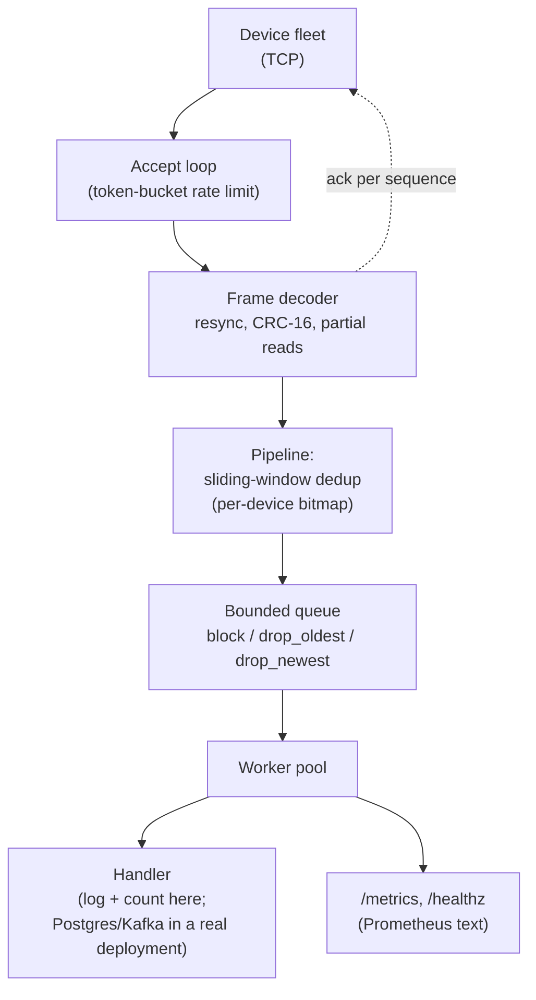

# device-gateway

[](https://github.com/saadbutt/device-gateway/actions/workflows/ci.yml)

A TCP ingest gateway for GPS and telemetry devices, written in Go with no third-party dependencies.

It is the part of a telematics platform that sits between hardware in the field and everything else: it accepts device connections, decodes a binary frame format, acknowledges every record, suppresses replays from devices that reconnect, and applies backpressure when the downstream cannot keep up.

I built it because the interesting problems in device ingest are not in the happy path. They are in what happens when 5,000 trackers behind carrier NAT all lose their uplink at once and reconnect within the same ten seconds.

## Tech stack

- **Language:** Go, standard library only — no third-party dependencies
- **Protocol:** a hand-rolled binary frame format over raw TCP, CRC-16/CCITT
- **Metrics:** Prometheus text exposition, hand-rolled (no client library)
- **CI:** GitHub Actions — gofmt, vet, full suite, race detector, arm64
  cross-compile

## Architecture



The handler is one function — logging and counting here, but it's the
extension point the [Layout](#layout) section below names as the intended
place to add TimescaleDB or Kafka. Everything left of it (decode, dedup,
backpressure) is what this repo is actually about.

## The problems it actually solves

**Frames do not arrive whole.** TCP is a byte stream. A reader that assumes one `Read` returns one frame works perfectly on localhost and fails in production. The decoder handles partial reads, resynchronises after a device that lost power mid-write, and rejects a length field that would otherwise let a malformed device allocate 64 KB per frame.

**Devices replay data, correctly.** The gateway acknowledges each sequence number, and a device only releases a buffered record once it sees that ack. If the link dies between the gateway writing an ack and the device receiving it, the device reconnects and sends the record again. It is not broken. A pipeline without deduplication quietly double-counts mileage, fuel and trip starts, and nobody notices until a customer disputes an invoice.

The fix is a sliding window per device, the same anti-replay construction IPsec uses: track the highest sequence seen plus a bitmap of the 1,024 below it. Constant time, one bit per sequence, and an LRU cap so that device IDs arriving on an open TCP port cannot grow the map without bound.

Note the asymmetry in the handling: a duplicate is **dropped but still acknowledged**. The device is asking again precisely because it never heard the first answer.

**Sockets lie about being alive.** Behind carrier NAT the usual failure is not a clean FIN. The mapping expires, the device is gone, and the gateway's socket looks healthy until it tries to write. TCP keepalive is measured in minutes on most kernels, which is far too slow for a live fleet view, so there is an application-level idle deadline on every read.

**Reconnect storms are self-amplifying.** When a carrier drops a region, every device in it comes back at once. Without a limit the gateway burns its CPU on accepts and goroutine creation while the devices already connected time out, which makes *them* reconnect too. Admitting connections through a token bucket is slower for any single device and dramatically faster for the fleet.

**Queues need a stated policy.** An unbounded channel is not a design, it is a deferred OOM. The overflow behaviour is explicit and configurable:

| Policy | Behaviour | Use when |
|---|---|---|
| `block` | Stops reading, TCP window closes, device buffers on its own flash | You would rather lose throughput than data |
| `drop_oldest` | Evicts the head | Live tracking, where a stale position is worthless |
| `drop_newest` | Refuses the arrival | Trip reconstruction, where a gap at the end beats a gap in the middle |

## Running it

```bash
go build ./cmd/...

# terminal 1
./gateway -addr :5027 -metrics-addr :9100

# terminal 2: 200 devices, 20 buffered records per flush,
# a 20% chance of dropping the link, and a total carrier outage every 30s
./simulator -addr localhost:5027 -devices 200 -batch 20 -drop-rate 0.2 -storm 30s
```

Or with Docker:

```bash
docker compose up --build
```

Then watch the replay suppression work:

```bash
curl -s localhost:9100/metrics | grep duplicate
```

A representative 12-second run, 40 devices, forced outage every 3 seconds:

```
sent=20580  acked=20580  replayed=9  reconnects=449

gateway_frames_total              20589
gateway_frames_duplicate_total        9
gateway_positions_persisted_total 20580
```

20,589 frames arrived, 9 were replays, 20,580 unique positions were stored. The arithmetic closes, which is the entire point.

## Layout

```
cmd/gateway        the server
cmd/simulator      a fleet of virtual trackers that drop, buffer and replay
internal/protocol  binary framing, CRC-16/CCITT, resync, partial-read handling
internal/gateway   accept loop, rate limiting, connection lifecycle, idle deadlines
internal/pipeline  sliding-window deduplication, bounded queue, worker pool
internal/metrics   Prometheus text exposition, hand-rolled
internal/config    flags and environment, with validation
```

## Why no dependencies

The metrics exposition and the token bucket are each about eighty lines. The Prometheus text format is stable and trivial to emit, and a token bucket is a well-understood piece of arithmetic. This binary is meant to run on small hardware in a depot, and a static build with nothing behind it is easier to trust and easier to ship than the convenience of pulling in two libraries and their transitive trees.

That trade would be wrong for a large application. It is right for this one.

## Configuration

Every flag has a `GATEWAY_`-prefixed environment equivalent; flags win.

| Flag | Default | |
|---|---|---|
| `-addr` | `:5027` | device listener |
| `-metrics-addr` | `:9100` | `/metrics` and `/healthz` |
| `-max-conns` | `10000` | concurrent connection cap |
| `-accept-rate` | `500` | sustained accepts per second |
| `-accept-burst` | `200` | burst allowance |
| `-idle-timeout` | `90s` | half-open socket detection |
| `-overflow` | `block` | `block`, `drop_oldest` or `drop_newest` |
| `-queue-size` | `4096` | ingest queue depth |
| `-workers` | `8` | pipeline workers |
| `-max-devices` | `50000` | deduplication window cap |

## Tests

```bash
go test ./... -race
```

The tests that matter are the ones that reproduce field behaviour rather than exercise getters:

- `TestOneByteAtATime` feeds the decoder a single byte per `Read`
- `TestResyncAfterGarbage` starts the stream mid-frame
- `TestReconnectReplayIsDeduplicated` drops a live connection with unacknowledged frames outstanding, reconnects, replays, and asserts nothing was counted twice
- `TestReconnectStorm` connects 60 devices simultaneously and accounts for every frame
- `TestBlockAppliesBackpressure` asserts `Submit` actually blocks rather than silently growing
- `TestShutdownDrainsQueue` asserts that acknowledged data is not discarded on SIGTERM

## What is deliberately left out

The pipeline handler logs and counts. In a deployment it would write to TimescaleDB or Postgres with a hypertable, or publish to Kafka. That boundary is one function, and swapping it is the intended extension point.

There is no TLS. Device fleets that need it usually terminate at the load balancer or use mutual TLS with per-device certificates, and either choice belongs to the deployment rather than to this binary.

There is no device authentication. The device ID is trusted as sent, which is fine for a demonstration and not fine for production. Real deployments key devices to a provisioning record and reject unknown IDs at accept time.

## Licence

MIT.
